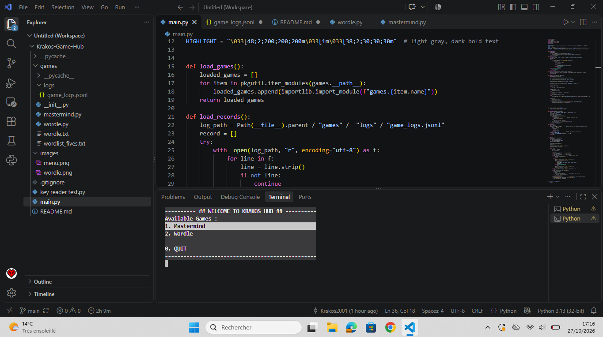
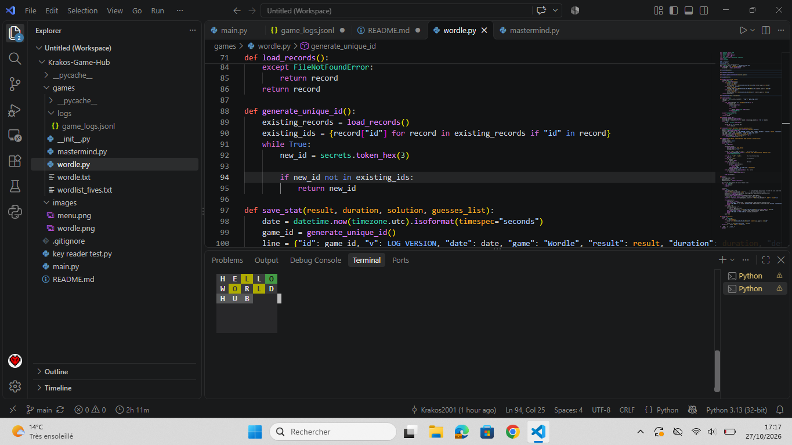
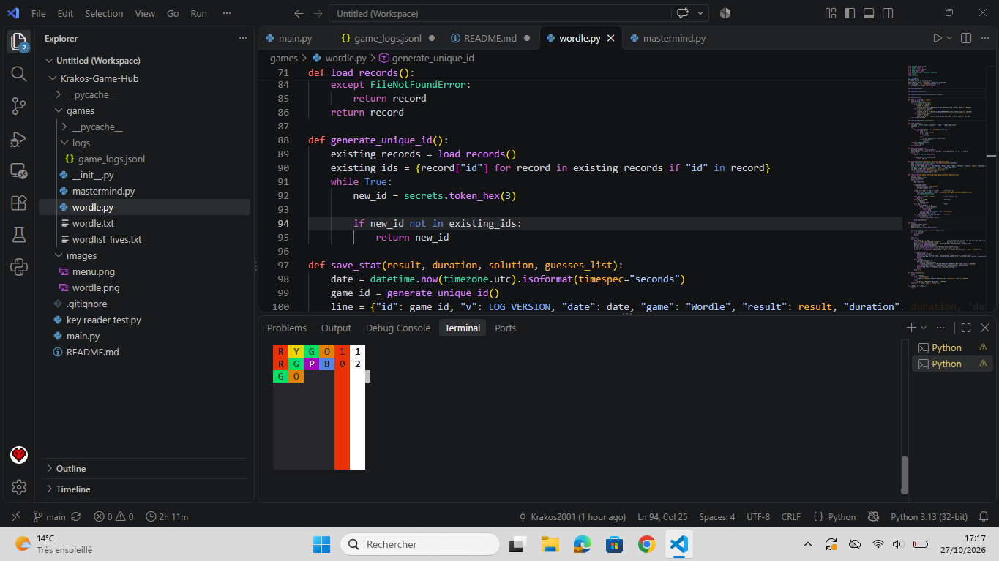

# Krakos Game Hub

# Description

A in-terminal hub for mini-games. Play games from a selection of homemade copies of the greatest web games. Your attemps are saved and are tracked with achievements. Made in Python

> Made for [Pixl](https://pixl.hackclub.com/refers?code=9B6LZH) by Hack Club.

### Hub menu


### Wordle board


### Mastermind board


## Features

- **No UI**: My majestic graphics are made with ANSI escape codes, no external libraries.
- **Interact with the terminal**, isn't played with consecutive lines, but the program actually deletes/modify lines to simulate a UI.
- **Automatic game discovery**: more of a coding ease than an user feature, but adding game is made easy: drop a new game in the `games/` folder and it shows up in the menu by itself (see **Adding a game** for more info).
- **Game tracking and achievements**: WIP but every win, loss or even abandoned game is tracked to give the most precise stats you could imagine (yes I'm a nerd, how could you tell).

## Requirements

- **Windows only** for now as key presses are read with the `msvcrt` module, might integrate Linux and Mac in future version.
- Python 3.13 (the version it was tested with).
- Runs directly in the IDE, so any code editor is fine.
- Make the terminal window tall enough to show the different menus and screens (about 12 lines is safe).
- Perfomance wise, its really not an issue lol, here are my specs:
    * **RAM** : 4GB @ 1867MHz
    * **SSD** : 120GB but about 2Mo is fine
    * **CPU** : Intel(R) Core(TM) m3-8100Y CPU @ 1.10GHz (1.61 GHz)
    * **GPU** : iGPU with 128MB **VRAM**

## How to run

Download the code and run main.py, or use the following commands:

```
git clone https://github.com/Krakos2001/Krakos-Game-Hub.git
cd Krakos-Game-Hub
python main.py
```

Run it from the project folder, so Python can find the `games` package.

## Controls

### In the hub

| Key | Action |
|---|---|
| Up / Down arrows | Move the highlight |
| `1`-`9` | Jump to that game |
| `0` | Jump to QUIT |
| Enter | Launch the selected game (or quit) |
| Esc / Ctrl+C | Quit the hub |

On a French AZERTY keyboard, the top row keys (`&`, `é`, `"`, `'`, `(`, `-`, `è`, `_`, `ç`) work as `1` to `9` without pressing Shift.

### In Wordle

| Key | Action |
|---|---|
| Letters | Type a letter in the current row |
| Backspace | Delete the last letter |
| Enter | Validate the word (it must be 5 letters and in the word list) |
| Ctrl+C | Leave the game and go back to the hub |

You have six attempts. After each guess:

- **Green**: the letter is in the right place.
- **Yellow**: the letter is in the word, but in another place.
- **Gray**: the letter is not in the word (or all its copies are already accounted for).

### In Mastermind

| Key | Action |
|---|---|
| Letters associated with colors | Type the corresponding color |
| Backspace | Delete the last color |
| Enter | Validate the combination |
| Ctrl+C | Leave the game and go back to the hub |

You have 4 attemps. After each attempts:

- The number in the **Red** box at the right correspond to the number of colors that were at their exact positions
- The number in the **White** box at the right correspond to the number of colors that are in the key (excluding one counted in the **Red** box) but weren't in their right positions.

## Project structure

```
Krakos-Game-Hub/
├── main.py              # the hub: finds the games and shows the menu
└── games/
    ├── __init__.py      # makes games/ a package (empty)
    |── mastermind.py    # the Mastemind game
    ├── wordle.py        # the Wordle game
    ├── wordle.txt       # solution words for Wordle
    └── wordlist_fives.txt   # accepted guesses for Wordle
        └── logs/
            └── game_logs.jsonl     # created when a game is saved, hold the records of game

```

## Adding a game

Every game is a Python file in `games/` that has two things:

1. a variable `NAME`, the text shown in the menu
2. a function `play()`, which the hub calls when the player picks the game

```python
# games/my_game.py
NAME = "My Game"

def play():
    ...
```

Restart the hub and "My Game" appears in the menu. If your game needs data files, put them in `games/` and build their paths with `Path(__file__).parent`, so they are found wherever the hub is launched from.

## Credits and data

- The word lists come from [John Burkardt's word datasets](https://people.sc.fsu.edu/~jburkardt/datasets/words/): `wordlist_fives.txt` for the accepted guesses and `wordle.txt` for the solutions. Check the terms on that page before reusing them.
- Wordle is a game created by Josh Wardle and now owned by The New York Times. This project is a fan-made imitation and is not affiliated with or endorsed by the NYT.
- Built as part of [Hack Club](https://hackclub.com)'s Pixl.

## Status and ideas

Working now: better logging of games, achievements, stats display

Ideas for later:

- More mini-games
- Cross-platform key reading (Mac and Linux)
- A multiplayer, and maybe an Online mode
